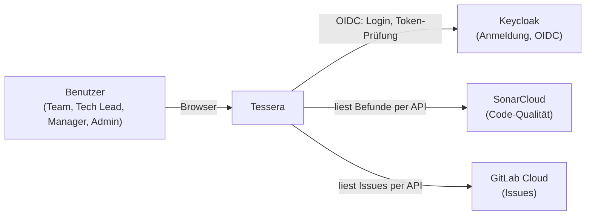
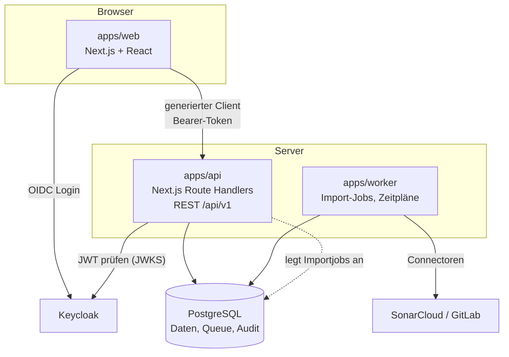
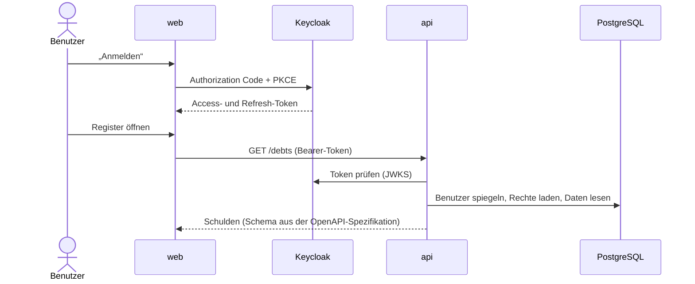
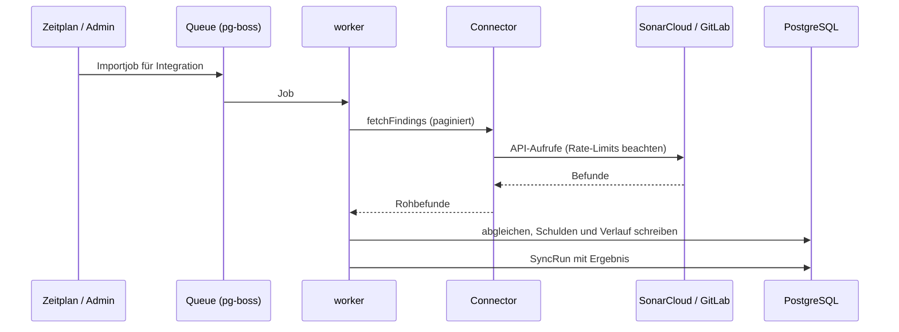

# Systemkontext und Bausteine

Diagramme sind in Mermaid geschrieben und werden von GitHub und GitLab direkt dargestellt.

## Systemkontext

Tessera **liest** aus SonarCloud und GitLab (Version 1: kein Rückschreiben). Benutzer und
Passwörter gehören Keycloak; Produktrollen verwaltet Tessera selbst.

## Bausteine

### Pakete und Verantwortung

| Baustein    | Pfad                  | Verantwortung                                                                                                                                       | Stand                                                         |
| ----------- | --------------------- | --------------------------------------------------------------------------------------------------------------------------------------------------- | ------------------------------------------------------------- |
| Web         | `apps/web`            | Oberfläche (Dashboard, Register, Detail, Prioritäten, Integrationen, Modellpflege), Login per Auth.js, ruft die API nur über den generierten Client | umgesetzt (Register, Bewertung); Dashboard/Verwaltung geplant |
| API         | `apps/api`            | Routen mit Zod-Schemas, Rechteprüfung, Services; erzeugt die OpenAPI-Spezifikation                                                                  | umgesetzt für Produkte, Benutzer, Schulden, Bewertung         |
| Worker      | `apps/worker`         | Importjobs, Zeitpläne, Tages-Snapshots (pg-boss)                                                                                                    | umgesetzt (Importjobs, Zeitplan, Tages-Snapshots)             |
| Domäne      | `packages/domain`     | reine Fachlogik: Statusregeln, Bewertung, Fehler                                                                                                    | umgesetzt; Abgleich geplant                                   |
| Datenbank   | `packages/db`         | Prisma-Schema, Migrationen, Seed                                                                                                                    | umgesetzt                                                     |
| Connectoren | `packages/connectors` | Schnittstelle und Quellen (SonarCloud, GitLab)                                                                                                      | umgesetzt (SonarCloud, GitLab Cloud)                          |
| API-Typen   | `packages/api-types`  | aus der OpenAPI-Spezifikation generierte Typen                                                                                                      | umgesetzt (generiert)                                         |

### Abhängigkeitsregeln

- `packages/domain` hat **keine** Abhängigkeit auf Datenbank, HTTP oder Frameworks.
- Das Frontend ruft das Backend ausschließlich über den generierten Client (ESLint-Regel erzwingt es).
- Connectoren schreiben nie selbst in die Datenbank; der Worker übernimmt das Ergebnis.
- Der Worker und die API teilen sich Datenbank und Domäne, aber keinen Prozess.

## Ablauf: Anmeldung und API-Aufruf

Abgelaufene Access-Tokens erneuert das Frontend über das Refresh-Token. Schlägt das fehl,
fordert die Startseite zur erneuten Anmeldung auf. „Abmelden“ beendet auch die Keycloak-Sitzung.

## Ablauf: Import

Regeln des Abgleichs: [Integrationskonzept](integration-concept.md).

## Datenhaltung

- Ein PostgreSQL für Fachdaten, Job-Queue und Audit (Prinzip VI).
- Der Verlauf einer Schuld (`debt_event`) und das Änderungsprotokoll (`audit_entry`) sind nur anfügend.
- Bewertungen sind unveränderlich; die Priorität einer Schuld wird daraus abgeleitet
  (`priority_calculated`), die manuelle Überschreibung steht daneben (`priority_override`),
  `priority_effective` ist eine generierte Spalte für Sortierung und Rangliste.
- Datenmodell im Detail: [data-model.md](../../specs/001-tech-debt-management/data-model.md).
